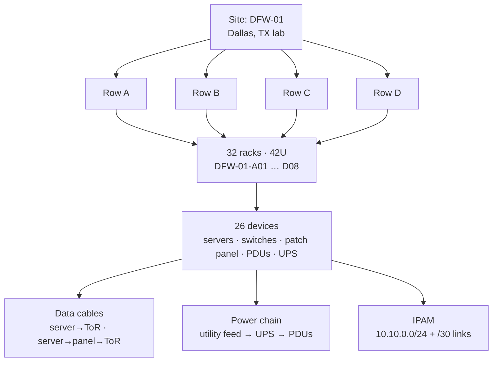

# netbox-dc-digital-twin

[](https://www.python.org/)
[](https://docs.docker.com/compose/)
[](LICENSE)

A **home-lab digital twin** of a small data center, modeled in [NetBox](https://netbox.dev/) and
seeded entirely through the NetBox REST API. Built as a portfolio project to demonstrate
data-center modeling skills: rack elevation planning, device/interface cabling, power-chain
modeling (utility feed → UPS → PDUs), and IPAM.

> Portfolio / home-lab project. The fictional site `DFW-01` represents no real facility,
> and the model makes no claims about any employer. All device models are common,
> representative hardware chosen for realism.

## Architecture

```
                    ┌─────────────────────────────┐
                    │           DFW-01            │  Site (1)
                    │   1234 Lab Way, Dallas TX   │  (fictional lab address)
                    └──────────────┬──────────────┘
                                   │
            ┌──────────┬───────────┼───────────┬──────────┐
            ▼          ▼           ▼           ▼          ▼
        Row A      Row B       Row C       Row D   (Rack groups)
       (8 racks)  (8 racks)   (8 racks)   (8 racks)  42U each
            │                                              │
            ▼                                              ▼
   ┌───────────────┐                              ┌───────────────┐
   │ Sample row A  │                              │  Rows B, C, D │
   │ (fully cabled)│                              │ (light model) │
   └───────┬───────┘                              └───────────────┘
           │
   ┌───────┴───────────────────────────────────────┐
   │ 6 servers → ToR switch (cat6)                 │  Cables
   │ 6 servers → patch panel → ToR (structured)    │  (data plant)
   │ utility feed → UPS → 2 PDUs                   │  (power plant)
   └───────┬───────────────────────────────────────┘
           │
   ┌───────┴───────────────────────────────────────┐
   │ IPAM: 10.10.0.0/24 mgmt + /30 p2p links       │
   └───────────────────────────────────────────────┘
```

Mermaid version:



## Prerequisites

- Docker Engine + Docker Compose v2
- ~4 GB RAM free (NetBox + Postgres + Redis)
- Python 3.10+ with `requests` (for the seed script)

## Quick start

```bash
# 1. Start the stack
cp .env.example .env   # fill in the required secrets
docker compose up -d

# 2. Install the seed script dependency
pip install -r requirements.txt

# 3. Export the API token of the superuser created at startup
export NETBOX_URL=http://localhost:8000
export NETBOX_TOKEN=<SUPERUSER_API_TOKEN from your .env>

# 4. Seed the digital twin (idempotent — safe to re-run)
python seed/seed_dc.py

# 5. Verify the model
python seed/verify.py
```

The superuser credentials come from the `.env` values `NETBOX_SUPERUSER_NAME` /
`NETBOX_SUPERUSER_PASSWORD`; the API token is `NETBOX_SUPERUSER_API_TOKEN` and is
created automatically on first boot.

## What the seed creates

| Object | Count | Notes |
|---|---:|---|
| Site | 1 | `DFW-01`, fictional Dallas lab address |
| Rack groups | 4 | Rows A–D |
| Racks | 32 | 4 rows × 8, 42U each, named `DFW-01-A01` … `D08` |
| Device roles | 5 | server, network-switch, patch-panel, pdu, ups |
| Device types | 5 | Dell PowerEdge R650, HPE ProLiant DL380 Gen10, Arista DCS-7050SX3-48, APC AP8886 PDU, APC Smart-UPS SRT 8000 |
| Devices | 26 | Row A fully populated (6 servers, ToR switch, patch panel, 2 PDUs, UPS); rows B–D each get 3 servers, a ToR switch, and a PDU |
| Interfaces | 86+ | Server `eth0/eth1`, switch ports, mgmt, uplinks |
| Patch-panel ports | 8 | 6 front / 2 rear (8p8c) on row-A panel |
| Prefixes | 3 | `10.10.0.0/24` management + two `/30` point-to-point links |
| IP addresses | ~29 | Assigned to server NICs, switch mgmt, uplinks |
| Cables | 17 | 14 data (row A) + 3 power |
| Power panels | 1 | `DFW-01-PP-1` |
| Power feeds | 1 | `DFW-01-PF-A1`, 208V/30A/3-phase → UPS → PDUs |

## Screenshots

_(Add screenshots here after `docker compose up`: e.g. the DFW-01 rack-elevation view,
the row-A cable map, and the IPAM prefix list.)_

## Project layout

```
netbox-dc-digital-twin/
├── docker-compose.yml   # NetBox + Postgres + Redis + worker, persistent media volume
├── seed/
│   ├── seed_dc.py       # Idempotent REST-API seed (the digital twin builder)
│   └── verify.py        # Count assertions; pass/fail table; nonzero exit on failure
├── requirements.txt     # requests
├── .gitignore
└── LICENSE              # MIT
```

## Design notes

- **Idempotency first:** every object is looked up by name/slug before `POST`, so the
  seed can be re-run after edits or partial failures without duplicating anything.
- **Row A is the showcase row:** complete data and power cabling; rows B–D model
  capacity at lower detail — realistic for how twins are built incrementally.
- **Power chain modeling:** utility feed → UPS → PDUs uses NetBox power panels,
  feeds, and cable terminations (`powerfeed` ↔ `powerport` ↔ `poweroutlet`).
- **No invented history:** this model was built as a home-lab exercise. Device models
  are real, representative hardware, but their placement here is purely illustrative.

## License

MIT — see [LICENSE](LICENSE).
